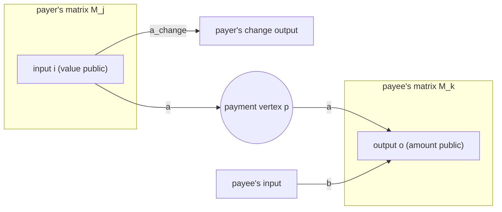
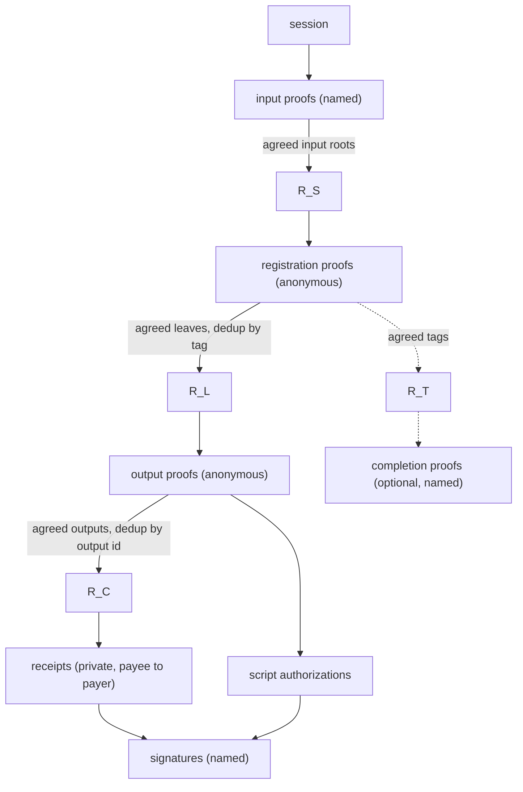
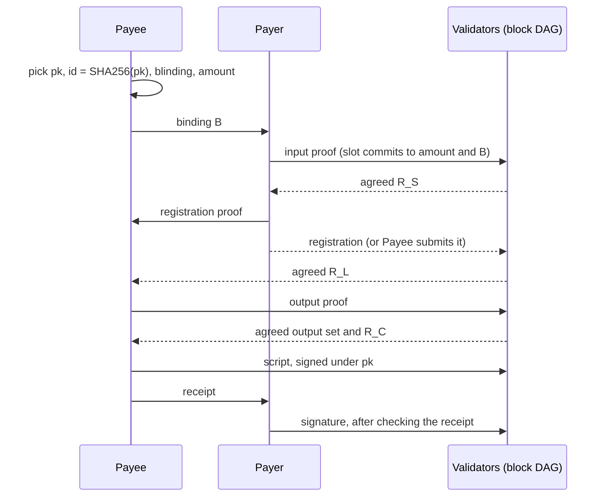

<!-- cspell:words arkworks blindings Camenisch dedup Groth Hohenberger Kohlweiss Lysyanskaya mathit mathrm mathsf Meyerovich RTAG ungated -->

# 🤖 Validity proofs by allocation registration

> **Status: candidate, under evaluation (2026-10-17).** This is the best
> approach found so far. Evaluation continues until validity proofs are
> needed. The code will then be rewritten from scratch for Fungi, and this
> document finalized. Figures marked *measured* come from a proof of concept
> on a shared machine; parts marked *proposed* are not implemented yet.

The [overview](overview.md#validity-proofs) explains when validity proofs are
needed: once overspending has been detected, outputs and fee contributions
must prove they are covered by input funds, without revealing how each
participant allocates its funds. This document specifies one way to do that.

## Why this approach

It balances the trade-offs better than the alternatives evaluated so far:

1. **Production-quality Rust crates.** The proofs use the
   [jellyfish](https://github.com/EspressoSystems/jellyfish) implementation
   of TurboPlonk with KZG commitments.
2. **Universal setup.** No per-circuit ceremony. Any BN254 powers-of-tau
   ceremony of degree at least 2,050 works for the required proofs. The
   optional completion proof needs 16,386 (8,194 for its variant). For example
   [Perpetual Powers of Tau](https://github.com/privacy-scaling-explorations/perpetualpowersoftau)
   or [Aztec Ignition](https://github.com/AztecProtocol/ignition-verification).
3. **Efficient for prover and verifier, even with payments.** Every proof is
   769 bytes. Each takes about 0.16–0.31 s to prove on one thread, and
   about 40–50 µs to verify in a batch (*measured*).

Payments need no proof about the payment from the payer to the payee, no
recursion and no multi-party computation. The payer only hands the payee its
registration proof early, which is a public object anyway.

## Requirements

| Requirement | Status |
|---|---|
| **Privacy.** No association among inputs and outputs beyond the public boundary and what counterparties know of their own payments. | Argued in [Privacy](#privacy), not formalized. Relies on anonymous submission. |
| **Counterparty privacy, both ways.** The payee doesn't learn the paying input; the payer doesn't learn the funded output. | Met by the [two trees](#two-trees-so-payer-and-payee-never-share-a-path) and the blinding $\beta$. |
| **No inflation.** Amounts are non-negative, each registered leaf funds at most one output, and outputs sum to at most the inputs. | Met; see [No value is created](#no-value-is-created). |
| **Flood protection.** Every admitted object spends a unit issued by an admitted input, so each phase admits a bounded number of statements. | Met: at most $D$ registrations per input, and each output claims a registered leaf. Duplicates count once and equivocation is removed ([Acceptance rules](#acceptance-rules)). |
| **Session binding.** No statement replays across sessions. | Met: every proof takes `session`, or a root agreed in the session, as a public input. |
| **Honest allocations can't be blocked.** Other participants can't consume or block an honest allocation, apart from the dependency between a payer and its payee. | Met: tags are per slot, and a leaf is claimable only under its own binding. Output ids must stay private until the output phase. |
| **Attributable failure.** A run either completes, or names an input that recovery can exclude. | Met by per-input signatures and the [signing rules](#signing-and-failures). Completion proofs are optional. |
| **Interactive payments and net settlement**, including recipients without inputs, intermediaries and cycles. | In scope. The circuits check any endpoint allocation within $D$ and $K$. The private messages for net settlement are open. |

## The flow graph

A transaction moves value from inputs to outputs. Each participant decides
how its own inputs' value is split. Some of that value goes to its own
outputs, and some to payments to other participants.

### As a matrix

Write the flows as a matrix $M$. Rows are sources and columns are sinks.
There are four kinds of vertex:

- **inputs**, whose values are public;
- **outputs**, whose amounts are public;
- **the fee**, a public sink: each input's hidden excess, or fee
  pseudo-outputs;
- **payment vertices**, one per payment. Each is shared by exactly one payer
  and one payee, and is not labelled publicly.

$M$ is the sum of one sparse matrix per participant, $M = \sum_j M_j$. A
participant's $M_j$ has non-zero entries only on edges at its own vertices,
or at payment vertices it shares:

- from its inputs to its own outputs;
- from its inputs to a payment vertex, if it is a payer;
- from a payment vertex to its outputs, if it is a payee.

A payment of $a$ from payer $j$ to payee $k$ through payment vertex $p$
appears in two blocks: the edge into $p$ in $M_j$, and the edge out of $p$
in $M_k$. Both edges stay in the sum. What cancels is the net flow at $p$:
$+a$ in from $M_j$, $-a$ out from $M_k$, so $p$ neither creates nor destroys
value. Contracting $p$ gives an entry of $a$ from the payer's input to the
payee's output.

Contracting every payment vertex leaves a bipartite allocation from inputs
to outputs and the fee. Payments are structure inside its edges, and don't
change its row and column sums. Those sums are public; its entries are not.

### What is observable

- **The boundary is public.** Row sums over input rows are the input values.
  Column sums over output columns are the output amounts. These are exactly
  the public inputs of the proofs below.
- **Each block is private to its participant.** The proofs reveal nothing
  about how a participant splits its inputs beyond the boundary.
- **Each payment entry is known to its payer and payee.** The payer knows its
  input and the amount. The payee knows the amount and its output. The
  proofs reveal neither side to the other.
- **No one is shown the full matrix.** In particular, the proofs don't reveal
  the entry from a payer's input to a payee's output.

These hold under the stated leakage: the public boundary, what counterparties
know of their own payments, and anonymous submission. Amounts, small
anonymity sets and colluding counterparties can still reveal more.

### How the proofs enforce it

The proofs check that no vertex creates value, without anyone assembling
$M$:

| Vertex | Conservation | Checked by |
|---|---|---|
| input | its slot amounts plus a hidden excess equal its public value | input proof |
| payment vertex | the payee can claim at most what the payer registered | registration proof plus output proof, linked by the binding |
| output | its claimed leaves sum to its public amount | output proof |

Anything registered but not claimed, or committed but not registered, becomes
fee. So the proofs give non-inflation, not that every payment arrives. That
each payment arrives is checked by the payer, through a receipt, before
signing.

The cost of each proof depends on one participant's block, a fixed small
number of slots, and on the tree depths fixed by the session's capacity. It
doesn't depend on the size of $M$.

## Intuition

### Slots, registration and outputs

Three steps carry value from an input to an output:

1. **Slots.** Each input splits its value into $D = 9$ slots. Each slot
   names an amount and a destination. The input commits to its slots with an
   input proof, posted under its name.
2. **Registration.** Each non-zero slot is turned into a *registered leaf* by
   a registration proof, posted anonymously. The proof shows the slot belongs
   to some admitted input without saying which.
3. **Outputs.** An output proves that up to $K = 2$ registered leaves name it
   as their destination, and that their amounts sum to its amount. It is
   posted anonymously.

A payment is just a slot whose destination is someone else's output. The
payer registers it; the payee claims it.

Interactive payments and [net settlement](overview.md#net-settlement) are
in scope. The circuits check only the endpoint allocation: slots from
inputs, registered, and claimed by outputs. They have no payment variables.
Payment obligations, including net settlement (a participant without inputs
that receives from A and pays C, or a cycle of payments), are mapped onto
slots, and confirmed with counterparties, by private messages around the
proofs. This document specifies those messages for a direct payment from an
input to an output; the rest is open. $D = 9$ and $K = 2$ bound the endpoint
allocation, not the number of payments.

### Two trees, so payer and payee never share a path

Each proof proves membership in a tree that everyone builds from public,
agreed data:

- the **session tree** over the inputs' slot commitments, used by
  registrations;
- the **registration tree** over registered leaves, used by outputs.

The payer's path, from slot to input, lives only inside its zero-knowledge
registration proof. The payee's path, from leaf to the registration tree's
root, is computed from public data. No input membership path crosses from
payer to payee, so the payee can't learn the paying input, and the payer
can't learn the funded output. What does pass between them is the binding
$B$, the registration proof and the receipt.

### A tag per slot limits each input to D registrations

Registration is anonymous, so something has to stop an input registering the
same slot twice. Each registration publishes a tag

$$\mathit{tag}_i = H_\mathsf{RTAG}(\mathit{session}, s, i),\quad 0 \le i \lt D,$$

where $s$ is a secret the input committed to. The tag is deterministic in
$(s, i)$, so a second registration of the same slot repeats the tag and is
dropped. It is pseudorandom without $s$, so it doesn't reveal the input. This
is the idea behind periodic $n$-times anonymous authentication.[^clone-wars]
Here the bound is the number of slots, and the slot's position in the tree
supplies $i$.

### Flood protection

Every admitted object spends a unit issued by an admitted input:

- a registration spends one of its input's $D$ slots, so there are at most
  $9 \times 729$ registrations;
- an output must claim at least one registered leaf, and each leaf can be
  claimed by only one output.

### Destination fixed at commitment

A slot commits to its destination's binding when the input proves
(*destination mode*). So the registered leaf is fully determined by the slot,
and any valid registration of a slot is identical. This is why the payee
must give the payer its binding $B$ before the payer's input proof.

The payer hands its registration proof to the payee once $R_S$ is agreed,
and either one can submit it. After the payee has it, the payer can't renege
by withholding its registration. It can only refuse to sign, and then its
input is named. Before that, the payer can still withhold the proof itself
(see [Signing and failures](#signing-and-failures)).

## Parameters

| Symbol | Value | Meaning |
|---|---|---|
| curve | BN254 | proof system field and pairing |
| proof system | TurboPlonk, KZG, jellyfish | universal setup |
| $H$ | Poseidon, width 4, rate 3, $\alpha = 5$, 8 full and 56 partial rounds | all in-circuit hashing |
| arity | 3 | every Merkle tree |
| $D$ | 9 | slots per input (2 tree levels) |
| inputs | at most 729 | session tree, 6 levels |
| registrations | at most 6,561 | registration tree, 8 levels |
| $K$ | 2 | registered leaves per output |
| amount bits | 51 | $2^{51} > $ 21 million BTC in satoshis |
| excess bits | 32 | an input's hidden fee share |

*Placeholder constants:* the proof of concept generates Poseidon constants
with arkworks' Grain generator. They are not the reference constants.
Production must load the reference constants.

## Hashes and objects

$H_\mathsf{dom}(x_1, \dots, x_m)$ is the Poseidon sponge with the capacity
element set to the domain constant $\mathsf{dom}$, absorbing three elements
per permutation. Each domain has a fixed input length. Tree nodes are one
permutation of $(\mathsf{NODE}, c_1, c_2, c_3)$.

In the proof of concept:

- The state is $(\mathsf{dom}, 0, 0, 0)$. Each block of up to three inputs
  is added to elements 1–3, then the state is permuted. The hash is element 1
  of the final state, and so is a tree node.
- Domain constants and input lengths:

  | Domain | Constant | Inputs |
  |---|---|---|
  | ALLOC | 7 | 3 |
  | OUT | 8 | 4 (two permutations) |
  | SLOT | 11 | 3 |
  | RTAG | 12 | 3 |
  | CLAIM | 13 | 3 |
  | SID | 14 | 1 |
  | NODE | $2^{32}$ | 3 children |

- Amounts and slot indices enter as field elements of their integer value.
- The output id is the first 31 bytes of the SHA-256 digest read as a
  little-endian integer. SHA-256 is taken over the 32-byte x-only
  serialization of $\mathit{pk}$.
- In the script authorization message, `session` and the id are 32-byte
  little-endian field encodings, followed by the raw script.
- Padding for trees smaller than their capacity is not defined yet. The
  jellyfish tests use random siblings. The Groth16 reference pads with a
  hash of a separate EMPTY domain, but under a different Poseidon instance.
- `session` is a hash of the
  [coalition formation](overview.md#coalition-formation) proposal.

| Object | Definition | Known to | Public |
|---|---|---|---|
| $s$ | random, fresh per input and per attempt | the input's owner | no |
| $a_i$, $B_i$ | slot $i$'s amount and destination binding | the input's owner; the payee for its own slot | no |
| slot | $\mathit{slot}_i = H_\mathsf{SLOT}(a_i, B_i, s)$ | the input's owner | no |
| input root | 2-level tree over $\mathit{slot}_0 \dots \mathit{slot}_8$ | everyone | yes |
| $R_S$ | session root: 6-level tree over the agreed input roots, in the agreed input order | everyone | yes |
| tag | $\mathit{tag}_i = H_\mathsf{RTAG}(\mathit{session}, s, i)$ | everyone, after registration | yes |
| leaf | $\mathit{leaf}_i = H_\mathsf{ALLOC}(a_i, B_i, \mathit{tag}_i)$ | everyone, after registration | yes |
| $R_L$ | registration root: 8-level tree over the agreed leaves, sorted by value (*proposed*) | everyone | yes |
| $R_T$ | tag root: 8-level tree over the agreed registrations' tags; only for completion proofs | everyone | yes |
| $\mathit{pk}$ | fresh key per output and per attempt; not a spending key | the payee | after outputs |
| output id | $\mathrm{SHA256}(\mathit{pk})$, first 31 bytes | the payee; everyone once the output is posted | yes |
| binding | $B = H_\mathsf{OUT}(\mathit{session}, \mathit{amount}, \mathit{id}, \beta)$ with a random blinding $\beta$ | the payee; the payer sees only $B$ | no |
| claim commitment | $\mathit{cc} = H_\mathsf{CLAIM}(u_1 \mathit{leaf}_1, u_2 \mathit{leaf}_2, r)$ | everyone | yes |
| $R_C$ | claim root: 8-level tree over the agreed outputs' claim commitments | everyone | yes |

The output id follows the [concurrent PSBT](overview.md#psbt-concurrency)
requirement that each output has a unique identifier. A scriptPubKey can't
serve, because it may not be stable until after the output set is. Taking the
id as the hash of a fresh key lets the payee later authorize the output's
script.

Never authorize by revealing $\beta$: the payer knows $B$, and could then
recompute it for each output and find the one it funded.

## Proof sequence and data dependencies

Each public phase ends with agreement on a common upper state (see the
[block DAG](optimistic-track.md#phase-agreement)). Everyone then
computes the phase's root from the agreed set. Proofs in the next phase use
that root, alongside their own public inputs. No proof depends on another
party's private proof.

| Step | Phase | Posted | By | Proof | Public inputs | Produces |
|---|---|---|---|---|---|---|
| 0 | coalition formation | — | aggregator | — | — | `session`, initial inputs |
| 1 | initial and auxiliary inputs | named | input owners | — | — | agreed input set |
| 2 | destination commitments | named | each input | input proof | `session`, value, input root | $R_S$ |
| 3 | allocation registration | anonymous | payer, or the payee holding its proof | registration proof | `session`, $R_S$, tag, leaf | $R_L$ |
| 3b | optional | named | each input | completion proof | `session`, input root, $R_T$ | shows the input's non-zero slots are all registered |
| 4 | outputs | anonymous | each output's owner | output proof | `session`, $R_L$, amount, output id, cc | output set, $R_C$ |
| 5 | script authorization | anonymous | each output's owner | signature | output id, $\mathit{pk}$, script | final outputs |
| 6 | signing | named | each input | — | — | transaction |

A repeat of auxiliary inputs with proofs changes $R_S$. Registrations and
output proofs are then made again.

## Synchronization requirements

### Public phases

Every public phase is a set to agree on, not a sequence. Proofs within a
phase are independent of each other. They depend only on the previous phase's
root, so they can be made and posted in any order and verified in one batch.
A phase's boundary is a phase transition in the
[block DAG](overview.md#synchronizing-protocol-state).

### Private messages between payer and payee

Each payment adds three private messages. Each must arrive inside a window
between two public agreements:

| Message | After | Before |
|---|---|---|
| payee → payer: binding $B$ | `session` known; output amount and id chosen | the payer's input proof |
| payer → payee: registration proof | $R_S$ agreed | registrations close |
| payee → payer: receipt | $R_C$ agreed | the payer signs |

What this means for being online:

- Payer and payee must both be online from the start of the session. That is
  needed for transaction liveness anyway.
- The payee fixes its output's amount and id before the payer's input proof.
  It fixes the script only after the output set.
- Third parties never see a pair's private messages. But a party waiting on
  one may delay its part in a public agreement, so third parties can wait on
  them indirectly. A stalled agreement is resolved by
  [recovery](overview.md#fault-tolerance-via-branched-execution), not by the proofs.

## Statements

All circuits are TurboPlonk over BN254 with the parameters above.

### Input proof

*Purpose:* conservation at an input, and commitment to its slots.

- **Public:** `session`, value (the input's amount), input root.
- **Witness:** $s$; for each slot, $a_i$ and $B_i$; the excess $e$.
- **Constraints:**
  - $a_i \lt 2^{51}$ for every slot, and $e \lt 2^{32}$;
  - $\sum_i a_i + e = \mathit{value}$;
  - the input root is the tree over $\mathit{slot}_i = H_\mathsf{SLOT}(a_i, B_i, s)$.
- **Cost (*measured*):** 1,855 gates, domain $2^{11}$, 0.31 s to prove.

The range checks stop a hidden slot of $p - x$ cancelling an oversized
slot. Nine 51-bit slots and a 32-bit excess can't wrap the field. The excess
is this input's share of the fee. Fee pseudo-outputs, which spend a slot like
an output, are an alternative. A zero slot needs no destination; any $B_i$
will do. A self-transfer is a slot whose binding is the participant's own
output.

### Registration proof

*Purpose:* turn a committed slot into an anonymous registered leaf, at most
once.

- **Public:** `session`, $R_S$, tag, leaf.
- **Witness:** $s$, $a_i$, $B_i$, the 8-level path from $\mathit{slot}_i$ to
  $R_S$.
- **Constraints:**
  - the path proves $\mathit{slot}_i$ is in $R_S$. The two inner levels expose
    the position as base-3 digits, which give $i$. The outer six hide which
    input it is;
  - $\mathit{tag} = H_\mathsf{RTAG}(\mathit{session}, s, i)$;
  - $\mathit{leaf} = H_\mathsf{ALLOC}(a_i, B_i, \mathit{tag})$, with the same
    $a_i$ and $B_i$ variables as the slot.
- **Cost (*measured*):** 1,017 gates, domain $2^{10}$, 0.16 s to prove.

No range check is needed, because $a_i$ is the slot's range-checked amount.

### Output proof

*Purpose:* conservation at an output.

- **Public:** `session`, $R_L$, amount, output id, cc.
- **Witness:** $\beta$; for $k \in \{1, 2\}$, $a_k$, $\mathit{tag}_k$
  and a path; $u_2$ (second source used); a filler value; $r$. $u_1$ is the
  constant 1. An unused source's path starts from the filler instead of its
  leaf, and is not checked against $R_L$, but the prover must still supply
  one.
- **Constraints:**
  - $B = H_\mathsf{OUT}(\mathit{session}, \mathit{amount}, \mathit{id}, \beta)$;
  - for each used source, $H_\mathsf{ALLOC}(a_k, B, \mathit{tag}_k)$ is in $R_L$;
  - $u_1 = 1$, so every output claims at least one leaf. Without this, an
    output with no sources and amount 0 would verify, and outputs would be
    ungated;
  - if both sources are used, their leaves differ;
  - $\sum_k u_k a_k = \mathit{amount}$;
  - $\mathit{cc} = H_\mathsf{CLAIM}(u_1 \mathit{leaf}_1, u_2 \mathit{leaf}_2, r)$.
    An unused source enters as 0, so a receipt can open only on a leaf the
    output actually spent.
- **Cost:** 1,935 gates, domain $2^{11}$ (*counted*). About 0.31 s to prove,
  measured at 2,028 gates in the same domain, before the output id replaced
  a script hash and an output tag.

$K = 2$ covers one payment plus the payee's own slot. A payee paid by
several payers uses one output per payment, or a larger $K$. Larger $K$ is not
measured. $K = 4$ probably moves to domain $2^{12}$, about 0.6 s
(*estimate*).

### Receipt (private)

*Purpose:* show the payer its payment was claimed, without saying which
output claimed it.

- **Public:** $R_C$, the payer's leaf.
- **Witness:** the output's claim commitment, its path to $R_C$, the other
  claimed leaf, $r$, and which side the payer's leaf is on.
- **Constraints:** the commitment is in $R_C$ and opens to the payer's leaf on
  one side.
- **Cost (*measured*):** 827 gates for an 8-level $R_C$, domain $2^{10}$,
  0.17 s to prove. A 6-level $R_C$ (729 outputs) is 645 gates (*counted*).
  It is verified only by the payer.

### Completion proof (optional)

Not part of the baseline. No other rule needs it: an omitted registration
only removes value from what can be claimed, and that value goes to the fee.
It can't inflate funds or consume another participant's allocation. A
counterparty that doesn't complete can make its partner withhold a
signature, which recovery already handles. The completion proof only adds
attribution within the pair: without it, a payer that reneges can make its
payee appear faulty. That is worth having only at marginal cost, and these
proofs don't look marginal.

*Purpose:* show that every non-zero slot of an input was registered. Where
the session requires it, an input that doesn't give one is named as
incomplete or unresponsive. That doesn't show who failed: the payer may not
have handed over its registration proof, or the payee may have received it
and not posted it.

- **Public:** `session`, input root, $R_T$.
- **Constraints:** for each slot, $a_i = 0$, or
  $\mathit{tag}_i = H_\mathsf{RTAG}(\mathit{session}, s, i)$ is in $R_T$.
- **Cost:** 8,578 gates, domain $2^{14}$ (*counted*). 2.3 s to prove,
  measured at 8,569 gates without destination bindings, in the same domain.

A variant publishes $\mathit{sid} = H_\mathsf{SID}(s)$ in the input proof and
binds the completion proof to it, with the same $R_T$. That fits $2^{13}$
(1.1 s). But it loses the zero-slot exemption: every input then registers
all nine slots, with dummies.

The root-bound proof could instead prove its leaves are in $R_L$, with no
$R_T$. That costs about 810 more gates, still in $2^{14}$ (*estimate*). The
sid variant can't, because it has no amounts or bindings.

## Acceptance rules

Every validator applies the same deterministic rules to the agreed sets:

- **Verification.** Each proof verifies against its circuit's fixed
  verifying key and the agreed root it names. A phase's proofs can be checked
  in one `batch_verify`, which accepts a mix of circuits.
- **Duplicates and equivocation.** These are validator rules, not part of
  the proofs; the proofs make them possible by exposing the tag and the
  output id as public keys. Proofs of the same statement are duplicates, even
  if their bytes differ, and are counted once. Different valid statements
  under one key are equivocation, and only identify which output every
  validator removes. An agreed set has no order, so no rule may depend on
  which arrived first. The
  proof of concept keeps the first in list order instead.
- **Registrations:** keyed by tag. The slot fixes the leaf, so every
  registration of a slot has the same statement, and equivocation can't
  happen.
- **Outputs:** keyed by output id. Two statements for one id can differ, in
  the claim commitment or in which leaves they spend. Only the id's owner can
  make both, unless the id leaked early. The output is removed, and its
  leaves' value goes to the fee.
- **Trees:** each in an order that doesn't depend on arrival:
  - $R_S$ over input roots in the agreed input order;
  - $R_L$ over agreed leaves sorted by value (*proposed*; the proof of
    concept uses arrival order);
  - $R_C$ over exactly the kept outputs' claim commitments, sorted by output
    id (*proposed*);
  - $R_T$, if completion proofs are used, over the kept registrations' tags.
- **Script authorization.** After the output set is agreed, each output's
  owner posts $(\mathit{pk}, \mathit{script}, \sigma)$, with $\mathit{pk}$ an
  x-only secp256k1 key. It is accepted if the first 31 bytes of
  $\mathrm{SHA256}(\mathit{pk})$ equal the output id, and $\sigma$ is a valid
  BIP 340 signature under $\mathit{pk}$ over
  $\mathrm{SHA256}(\mathit{session} \| \mathit{id} \| \mathit{script})$.
  Conflicting authorizations for one id are equivocation, and remove the
  output. This matters only for consistency, not for incentives. Removal is
  simpler than any other way to break the tie. The proof
  of concept checks the output proof, key hash and signature together, as one
  posted output. The spec separates them because the script may only be
  stable after the output set is.
- **Balance.** The fee is $\sum \mathit{value} - \sum \mathit{amount}$. It is
  public and must meet the session's terms.

## Signing and failures

The rules for signing:

- **A payer signs only after verifying a receipt** for each of its payments,
  and only the complete transaction with every output's script authorized.
  Otherwise it risks its funds going to the fee. A receipt shows the payment
  was claimed in $R_C$; it doesn't show the script or the settlement.
- **A payee signs its own inputs only if its output is in the transaction**
  with the agreed amount and script.

If either fails, the other $n - 2$ participants must be able to make
progress without them:

- **A refusal is attributable.** Signatures are per input, so an input that
  doesn't sign is named. Blame may fall on the pair, payer or payee or both,
  because they trust each other for liveness. They don't trust third parties
  for it.
- **Retry from the destination commitments without the named input.** The
  retry is a new recovery proposal, so it has a new `session`, and keeps the
  exclusions of earlier attempts. Everything from the input proofs on is
  redone with fresh secrets, amounts, keys and output ids. That is about 1.1 s of proving per participant on one thread: an
  input, two registrations, an output and a receipt (*derived*).
- **Not in place.** Continuing the same attempt without the named input
  would show which outputs drop out. Those are exactly that input's payees,
  so the link would leak for whichever member of the pair was honest.

What each failure costs:

| Failure | Who is named | Who loses |
|---|---|---|
| payer refuses to sign after a valid receipt | the payer's input | the payee's payment, until the retry |
| payee never claims | the payer's input (no receipt, so it won't sign) | the pair |
| payer never hands over its registration proof | the payer's input, if it follows the signing rule (no receipt); the payee's inputs, if it has any and refuses to sign; with completion proofs required, an input that can't give one, which is the same if the payee received the proof and didn't post it | the pair |
| anyone posts an invalid proof | nobody needs to be: it is rejected | nobody |

A payee that never claims can get each payer who agreed to pay it named once.
That stays within the trust the pair placed in each other. A missing
completion proof shows that an input didn't meet its obligations, under the
session's rules. It doesn't show whether that was malice or failure.

## Security sketch

### No value is created

1. **Input:** the hidden slots plus the excess equal the public value, and
   none can be negative.
2. **Registration:** each slot registers at most once, because its tag is
   unique. A leaf carries the slot's own amount and binding.
3. **One output:** its used leaves are distinct, and they sum to its amount.
4. **Across outputs:** a leaf names one binding, which contains one output
   id. Outputs are deduplicated by output id, so no leaf is claimed twice.

So $\sum \mathit{amount} \le \sum \mathit{registered} \le \sum \mathit{value}$.
The rest is fee. This is non-inflation only. That each payment arrives is a
separate check, by receipts before signing, and failures are attributed as in
[Signing and failures](#signing-and-failures).

Non-inflation needs only the dedup by output id and the binding. Keeping the
output id private until the output phase protects liveness instead. To take
over an honest output's id, an attacker needs registered leaves bound to a
binding containing that id. Slots fix their bindings in the input proofs, so
that is impossible unless the payee leaks its id before then. In the proof of
concept even a leaked id can't be taken: an output is accepted only together
with a signature under the key the id hashes. With script authorization as a
separate phase, the output phase could carry such a signature too
(*proposed*).

### Privacy

- **The payee doesn't learn the paying input.** The payer's path is a
  zero-knowledge witness. Tags are pseudorandom without $s$.
- **The payer doesn't learn the funded output.** It knows only $B$. The output
  id becomes public when the output is posted, but the blinding never leaves
  the payee, so the payer can't match $B$ to it. The receipt hides which
  commitment it opens.
- **Registrations are unlinkable to inputs.** This assumes anonymous
  submission, and tree orders that don't depend on arrival.
  Peers submit over a sender-anonymous transport. If the transport doesn't
  provide message unlinkability, each connection carries only one message.
  The sender checks through gossip that its message reached the peers.
- **Payments per output are hidden.** Every output proof has $K$ source
  positions, whether the second is used is a witness, and the claim
  commitment hides which leaves it spent.
- **The payment count depends on the session's terms.** The number of
  registrations is public. If the terms fix the number of registrations per
  input, with zero slots registered as dummies to fill it, the count reveals
  nothing about payments. The numbers of inputs and outputs are inherently
  public.

  The fixed number should make enough payments plausible that actual
  payments could change the analysis significantly. A handful of plausible
  payments in a large transaction is a strong constraint, suggesting the
  sub-transaction model may apply. No proof enforces the number; an input
  that registers fewer only weakens it.
- **Proofs are zero-knowledge as configured.** jellyfish masks the wire,
  permutation and quotient polynomials when proving.

### Assumptions

- KZG and TurboPlonk on BN254 in the algebraic group model, with a ceremony
  that had at least one honest contributor.
- BN254's security is about 100 bits, not 128.
- Poseidon is collision resistant, and pseudorandom when keyed by $s$ (tags).
- $B$ and the claim commitment hide their contents, given their random
  blindings $\beta$ and $r$.
- Anonymous submission of registrations and outputs.

Attempting a transaction leaks information that no proof can hide. Fresh
amounts, keys and output ids on each attempt limit what recurs across
attempts.

## Performance

*Measured* with jellyfish on BN254, under load 3–6, medians of 3:

| Proof | Gates | Domain | Prove, 1 / 10 threads | Verify, single | Batched, per proof |
|---|---|---|---|---|---|
| input | 1,855 | $2^{11}$ | 309 / 66 ms | 1.22 ms | 50 µs |
| registration | 1,017 | $2^{10}$ | 164 / 37 ms | 1.26 ms | 51 µs |
| output, with claim commitment | 1,935 | $2^{11}$ | 313 / 65 ms | 1.26 ms | 43 µs |
| receipt | 827 | $2^{10}$ | 165 / 36 ms | 1.24 ms | 43 µs |
| completion (optional) | 8,578 | $2^{14}$ | 2,261 / 440 ms[^value-mode] | 1.22 ms | 42 µs |

Every proof is 769 bytes, and each verifying key is 1,146 bytes.

A session with 500 inputs, 1,000 registrations and 500 outputs has 2,000
proofs, 1.79 MB including public inputs. It verifies in one batch in 90 ms on
one thread, or 21 ms on ten. Each participant proves in about 1 s on one
thread: one input, two registrations and one output.

### Compared with other approaches

For an output funded by two payers:

| Approach | Setup | Bytes | Payee proving |
|---|---|---|---|
| this one | universal | 2,723 (two registrations and one output, with public inputs) | 0.31 s |
| split proving, Groth16 | per circuit | 1,176, with public inputs | not measured |
| recursion, Groth16 two-chain | per circuit | 484 | 6.0 s |

## Open questions

- Sorting the registration tree.
- The private messages for net settlement: payments through participants
  without inputs, and cycles, mapped to slots bound to final outputs.
- Whether the output phase carries a signature under the output id's key.
- Tree padding.
- Measured cost of the output proof with the output id, and of $K > 2$.
- Whether to keep completion proofs at all, as an optional extension.
- Where allocation registration sits relative to the unproven output phase of
  the optimistic branch.
- Whether the concurrent PSBT specification already authenticates a late
  script for an output id, so script authorization can reuse it.
- Reference Poseidon constants, and the choice of ceremony.
- The number of registrations per input to fix in the session's terms, and
  its cost: 0.16 s and 769 B per dummy registration.

[^value-mode]: Measured at 8,569 gates, without destination bindings.

[^clone-wars]: J. Camenisch, S. Hohenberger, M. Kohlweiss, A. Lysyanskaya and M. Meyerovich, [*How to Win the Clone Wars: Efficient Periodic n-Times Anonymous Authentication*](https://eprint.iacr.org/2006/454) (2006).
